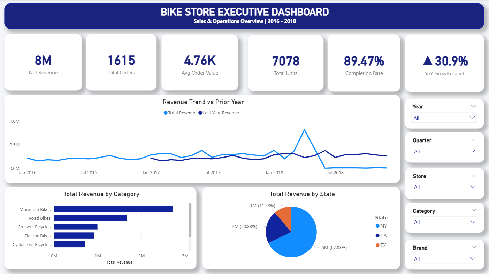

# 📊 Bike Store Sales & Operations Dashboard

## 📌 Project Overview
Interactive 5-page Power BI dashboard analyzing 4,700+ bike store 
transactions across 3 stores (2016–2018) covering sales, inventory, 
and staff performance.

## 🔍 Key Features
- Star Schema data model across 9 relational tables
- 20+ DAX measures including YoY, MTD, YTD, Rolling 3M, RANKX
- Power Query transformations with custom M Language Date Table
- Drill-through to Product Detail page
- Custom tooltips showing MTD/QTD/YTD on hover
- Sync slicers across all pages

## 🛠️ Tools Used
- Power BI Desktop
- Power Query (M Language)
- DAX
- Data: 4,723 order items | 9 tables | 3 stores | 322 products

## 📁 Files
| File | Description |
|------|-------------|
| `BikeStore_Executive_Dashboard.pbix` | Main Power BI dashboard file |
| `dashboard_preview.png` | Dashboard screenshot |
| `/data/customers.csv` | Customer data — 1,446 records |
| `/data/orders.csv` | Orders data — 1,616 records |
| `/data/order_items.csv` | Order line items — 4,723 records |
| `/data/products.csv` | Product catalogue — 322 products |
| `/data/stores.csv` | Store locations — 3 stores |
| `/data/staffs.csv` | Staff details — 10 members |
| `/data/stocks.csv` | Inventory levels — 939 records |
| `/data/categories.csv` | Product categories — 7 categories |
| `/data/brands.csv` | Brand names — 9 brands |

## 👤 Author
**Niranjan V A** | MIS Executive
📧 niranjanva1104@gmail.com | 🔗 www.linkedin.com/in/niranjan-v-a-
